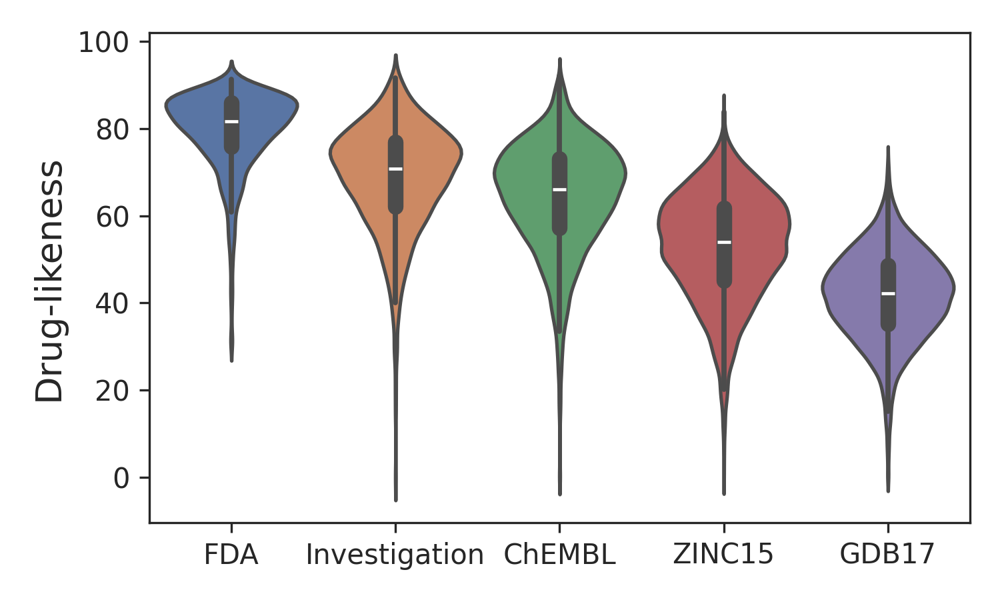

# Drug-likeness scoring based on unsupervised learning



This repository provides **DeepDL**, the model from [Drug-likeness scoring based on unsupervised learning](https://pubs.rsc.org/en/content/articlehtml/2022/sc/d1sc05248a), and **ChemPrior**, a Transformer-based SMILES model.
The original DeepDL code is available at [SeonghwanSeo/DeepDL](https://github.com/SeonghwanSeo/DeepDL).

For questions, open an issue or contact <shwan0106@gmail.com>.

## Quick Start

```bash
# Score one molecule with DeepDL.
python scoring.py 'CC(=O)Oc1ccccc1C(=O)O'
# score: 88.856

# Screen a SMILES file using a single stereoisomer per molecule.
python screening.py data/examples/chembl_1k.smi -o out.csv --mode naive --cuda

# Use a trained ChemPrior model.
python scoring.py 'CC(=O)Oc1ccccc1C(=O)O' --arch chemprior --model large-chembl
```

Higher scores indicate higher drug-likeness.
By default, DeepDL uses the lowest score among enumerated stereoisomers, while ChemPrior preserves the input stereochemistry.
`--mode naive` evaluates only the first isomer.
DeepDL scores range from 0 to 100; ChemPrior scores range from 0 to 1.

## Installation

Python 3.9 or later is required.

```bash
pip install druglikeness

# Install the current source.
git clone https://github.com/SeonghwanSeo/drug-likeness.git
cd drug-likeness
pip install -e .

# ChemPrior inference.
pip install -e '.[chemprior]'

# Training and dataset preparation.
pip install -e '.[train,chemprior]'
```

Run the following repository commands from the repository root.

## Python API

### DeepDL

```python
from druglikeness.deepdl import DeepDL

# A model name downloads weights from Hugging Face; local model directories also work.
model = DeepDL.from_pretrained("extended", device="cpu")
score = model.scoring("CC(=O)Oc1ccccc1C(=O)O")
scores = model.screening(["c1ccccc1", "CCN"], batch_size=64, naive=True)
```

### ChemPrior

```python
from druglikeness.chemprior import ChemPrior

model = ChemPrior.from_pretrained("SeonghwanSeo/chemprior-large-chembl")
score = model.scoring("CC(=O)Oc1ccccc1C(=O)O")
scores = model.screening(["c1ccccc1", "CCN"], batch_size=64, stereo_mode="original")

# Return summed log probability without clipping or rescaling.
log_probs = model.screening(["c1ccccc1", "CCN"], normalize=False)
```

## Model List

### DeepDL

| Model | Hugging Face repository | Description |
| --- | --- | --- |
| `extended` (default) | [deepdl-extended](https://huggingface.co/SeonghwanSeo/deepdl-extended) | Trained on an updated drug dataset, excluding the FDA-approved test set |
| `chemsci-2025` | [deepdl-chemsci-2025](https://huggingface.co/SeonghwanSeo/deepdl-chemsci-2025) | Retrained paper model with hyperparameter tuning |
| `chemsci-2021` | [deepdl-chemsci-2021](https://huggingface.co/SeonghwanSeo/deepdl-chemsci-2021) | Paper model: PubChem pretraining followed by World Drug fine-tuning |
| `pretrain` / `chemsci-2021-pretrain` | [deepdl-pretrain](https://huggingface.co/SeonghwanSeo/deepdl-pretrain) | PubChem pretrained model from the paper |

#### Performance

AUROC on FDA-approved drugs versus each comparison dataset:

| Model | Mode | FDA vs ChEMBL | FDA vs ZINC15 | FDA vs GDB17 |
| --- | --- | ---: | ---: | ---: |
| `extended` | strict | 0.862 | 0.961 | 0.991 |
| `extended` | naive | 0.861 | 0.961 | 0.989 |
| `chemsci-2025` | strict | 0.817 | 0.941 | 0.984 |
| `chemsci-2025` | naive | 0.817 | 0.941 | 0.982 |


### ChemPrior

ChemPrior supports three Transformer presets.
We provide both pretrained and ChEMBL fine-tuned models for each preset.
Pretraining uses 2,009,894,852 unique canonical SMILES from ZINC20 and PubChem, and fine-tuning uses 2,499,615 ChEMBL37 molecules.

| Preset | Hidden size | Layers | Attention heads | Pretrain | ChEMBL |
| --- | ---: | ---: | ---: | --- | --- |
| `large` | 512 | 12 | 8 | [`large-pretrain`](https://huggingface.co/SeonghwanSeo/chemprior-large-pretrain) | [`large-chembl`](https://huggingface.co/SeonghwanSeo/chemprior-large-chembl) |
| `medium` | 384 | 8 | 6 | [`medium-pretrain`](https://huggingface.co/SeonghwanSeo/chemprior-medium-pretrain) | [`medium-chembl`](https://huggingface.co/SeonghwanSeo/chemprior-medium-chembl) |
| `small` | 256 | 8 | 4 | [`small-pretrain`](https://huggingface.co/SeonghwanSeo/chemprior-small-pretrain) | [`small-chembl`](https://huggingface.co/SeonghwanSeo/chemprior-small-chembl) |


## Train Model

The model training pipeline relies on PyTorch Lightning.
Install the training dependencies with `pip install -e '.[train]'`.

```bash
pip install -e '.[train]'
```

### DeepDL

Fine-tune the PubChem pretrained model with your own `.smi` file:

```bash
# Train DeepDL on your own SMILES file.
python scripts/deepdl/train.py --data_path my-molecules.smi

# Or use the training data from the paper.
pip install gdown  # Only needed for the legacy dataset download script.
bash scripts/deepdl/download_data.sh
python scripts/deepdl/train.py --data_path data/train/worlddrug_not_fda.smi
```

### ChemPrior

Use [`configs/chemprior/finetune.yaml`](configs/chemprior/finetune.yaml) to fine-tune a ChEMBL model on your own dataset.
Prepare a Parquet dataset with `id` and `smiles` columns and row counts for each split. [Custom ChemPrior datasets](docs/chemprior-data.md)

- Set `dataset.path` to your local dataset directory.
- Set `dataset.train_split` and `dataset.val_split` to existing splits.
- Set `train.pretrained_model` to `small-chembl`, `medium-chembl`, or `large-chembl` (default), or a local model directory.
- Set `run.save_dir` to the directory where the fine-tuned model and checkpoints should be saved.

```bash
python scripts/chemprior/train.py configs/chemprior/finetune.yaml
```

For a new run, leave `run.resume_checkpoint` set to `null` to initialize from `train.pretrained_model`.
To resume an interrupted run, set `run.resume_checkpoint` to its Lightning checkpoint.

## Evaluation

Evaluate DeepDL on the paper's test datasets:

```bash
bash scripts/deepdl/download_data.sh
python scripts/deepdl/evaluate.py --cuda
```

The legacy dataset download script requires a separate `pip install gdown`; model downloads use Hugging Face and do not require it.
The script reports mean scores and FDA AUROC against Investigation, ChEMBL, ZINC15 and GDB17.
Install `.[eval]` to use `--plot`.

## Citation

```bibtex
@article{lee2022drug,
  title={Drug-likeness scoring based on unsupervised learning},
  author={Lee, Kyunghoon and Jang, Jinho and Seo, Seonghwan and Lim, Jaechang and Kim, Woo Youn},
  journal={Chemical science},
  volume={13},
  number={2},
  pages={554--565},
  year={2022},
  publisher={Royal Society of Chemistry}
}
```
