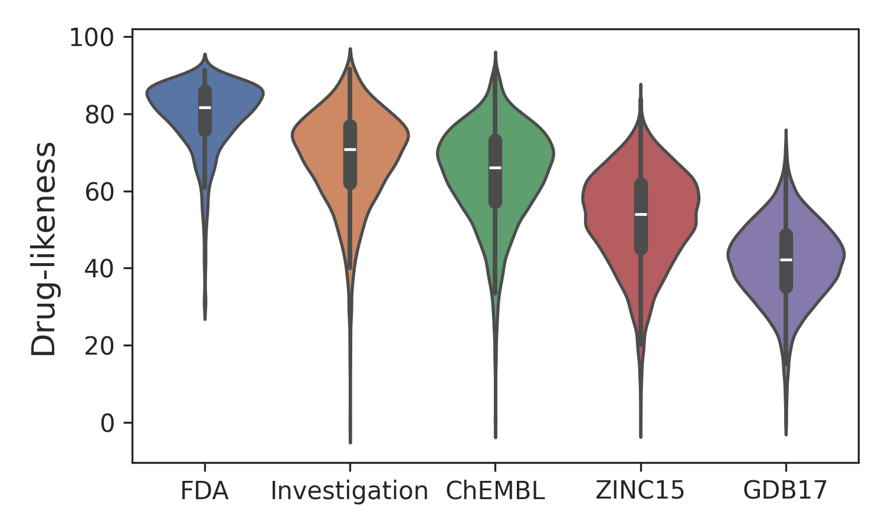

# Drug-likeness scoring based on unsupervised learning



This repository provides **DeepDL**, the model from [Drug-likeness scoring based on unsupervised learning](https://pubs.rsc.org/en/content/articlehtml/2022/sc/d1sc05248a), and **ChemPrior**, a Transformer-based SMILES model.
The original DeepDL code is available at [SeonghwanSeo/DeepDL](https://github.com/SeonghwanSeo/DeepDL).

For questions, open an issue or contact <shwan0106@kaist.ac.kr>.

## Quick Start

```bash
# Score one molecule with DeepDL.
python scoring.py 'CC(=O)Oc1ccccc1C(=O)O'
# score: 88.856

# Screen a SMILES file using a single stereoisomer per molecule.
python screening.py data/examples/chembl_1k.smi -o out.csv --naive --cuda

# Use a trained ChemPrior model.
python scoring.py 'CC(=O)Oc1ccccc1C(=O)O' \
    --arch chemprior --model results/chemprior-small/midtrain/model.pt
```

Higher scores indicate higher drug-likeness.
By default, scoring uses the lowest score among enumerated stereoisomers.
`--naive` evaluates only the first isomer.
DeepDL scores range from 0 to 100; ChemPrior scores range from 0 to 1.

## Installation

Python 3.9 or later is required.

```bash
pip install druglikeness

# Install the current source.
git clone https://github.com/SeonghwanSeo/drug-likeness.git
cd drug-likeness
pip install -e .

# ChemPrior inference.
pip install -e '.[chemprior]'

# Training and dataset preparation.
pip install -e '.[train,chemprior]'
```

Run the following repository commands from the repository root.

## Python API

### DeepDL

```python
from druglikeness.deepdl import DeepDL

# A model name downloads weights automatically; local checkpoint paths also work.
model = DeepDL.from_pretrained("extended", device="cpu")
score = model.scoring("CC(=O)Oc1ccccc1C(=O)O")
scores = model.screening(["c1ccccc1", "CCN"], batch_size=64, naive=True)
```

### ChemPrior

```python
from druglikeness.chemprior import ChemPrior

model = ChemPrior.from_pretrained("results/chemprior-small/midtrain/model.pt")
score = model.scoring("CC(=O)Oc1ccccc1C(=O)O")
scores = model.screening(["c1ccccc1", "CCN"], batch_size=64, naive=True)

# Return summed log probability without clipping or rescaling.
log_probs = model.screening(["c1ccccc1", "CCN"], normalize=False)
```

ChemPrior loads an exported `model.pt` or a ChemPrior Lightning checkpoint.
`normalize=False` returns log probability including EOS and excluding padding; stereoisomer selection follows the same scoring rule.

## Model List

### DeepDL

| Model | Description |
| --- | --- |
| `extended` (default) | Trained on an updated drug dataset, excluding the FDA-approved test set |
| `chemsci-2025` | Retrained paper model with hyperparameter tuning |
| `chemsci-2021` | Paper model: PubChem pretraining followed by World Drug fine-tuning |
| `chemsci-2021-pretrain` | PubChem pretrained model from the paper |

Weights can also be downloaded from [Google Drive](https://drive.google.com/drive/folders/1yMxR7HwmwH8wK1mA3wgEasOZ510Ib1-o?usp=share_link).

### ChemPrior

ChemPrior supports three Transformer presets.
Use your trained checkpoint for inference.

| Preset | Hidden size | Layers | Attention heads |
| --- | ---: | ---: | ---: |
| `small` | 256 | 8 | 4 |
| `medium` | 384 | 8 | 6 |
| `large` | 512 | 12 | 8 |

### DeepDL Performance

AUROC on FDA-approved drugs versus each comparison dataset:

| Model | Mode | FDA vs ChEMBL | FDA vs ZINC15 | FDA vs GDB17 |
| --- | --- | ---: | ---: | ---: |
| `extended` | strict | 0.862 | 0.961 | 0.991 |
| `extended` | naive | 0.861 | 0.961 | 0.989 |
| `chemsci-2025` | strict | 0.817 | 0.941 | 0.984 |
| `chemsci-2025` | naive | 0.817 | 0.941 | 0.982 |

## Train Model

### DeepDL Fine-tuning

Fine-tune the PubChem pretrained model with your own `.smi` file:

```bash
pip install -e '.[train]'
python scripts/deepdl/train.py --data_path my-molecules.smi

# Or use the training data from the paper.
bash scripts/deepdl/download_data.sh
python scripts/deepdl/train.py --data_path data/train/worlddrug_not_fda.smi
```

### ChemPrior Training

Choose a YAML template in `configs/chemprior/`:

```bash
pip install -e '.[train,chemprior]'
python scripts/chemprior/train.py configs/chemprior/small_1_pretrain.yaml
python scripts/chemprior/train.py configs/chemprior/small_2_midtrain.yaml

# Resume an interrupted run.
python scripts/chemprior/train.py configs/chemprior/small_1_pretrain.yaml \
    --resume_checkpoint results/chemprior-small/pretrain/checkpoints/last.ckpt
```

The templates stream the private [SeonghwanSeo/chemprior-data](https://huggingface.co/datasets/SeonghwanSeo/chemprior-data) repository and require Hugging Face access credentials.
Pretraining uses the merged ZINC20 + PubChem `pretrain` subset; midtraining continues on salt-free ChEMBL37 parents in the `chembl` subset.
ChEMBL has a 90%/5%/5% train/validation/test split, without similarity filtering.

Edit the three config groups for your run:

- `dataset`: data source, splits, token limit and stereo enumeration.
- `train`: model size, initial weights, batch size, epochs and learning rate.
- `run`: output directory, devices, precision and logging.

`dataset.enumerate_stereo: false` tokenizes stored SMILES directly.
Set it to `true` to sample an enumeration of unspecified stereochemistry during training, preserving assigned stereo.
`train.batch_size` is per device; `global_batch_size` must be a positive multiple of batch size times device count.
Training writes `config.json`, checkpoints and a final `model.pt` under `run.save_dir`.

For your own dataset, convert tab-separated SMILES and IDs to Parquet:

```bash
python scripts/chemprior/to_parquet.py my-molecules.smi --output data/my-parquet
```

Set `dataset.path` to your prepared dataset and include its split row counts in HF README metadata.
See [Custom ChemPrior datasets](docs/chemprior-data.md) for input format, metadata and config examples.

## Evaluation

Evaluate DeepDL on the paper's test datasets:

```bash
bash scripts/deepdl/download_data.sh
python scripts/deepdl/evaluate.py --cuda
```

The script reports mean scores and FDA AUROC against Investigation, ChEMBL, ZINC15 and GDB17.
Install `.[eval]` to use `--plot`.

## Citation

```bibtex
@article{lee2022drug,
  title={Drug-likeness scoring based on unsupervised learning},
  author={Lee, Kyunghoon and Jang, Jinho and Seo, Seonghwan and Lim, Jaechang and Kim, Woo Youn},
  journal={Chemical science},
  volume={13},
  number={2},
  pages={554--565},
  year={2022},
  publisher={Royal Society of Chemistry}
}
```
